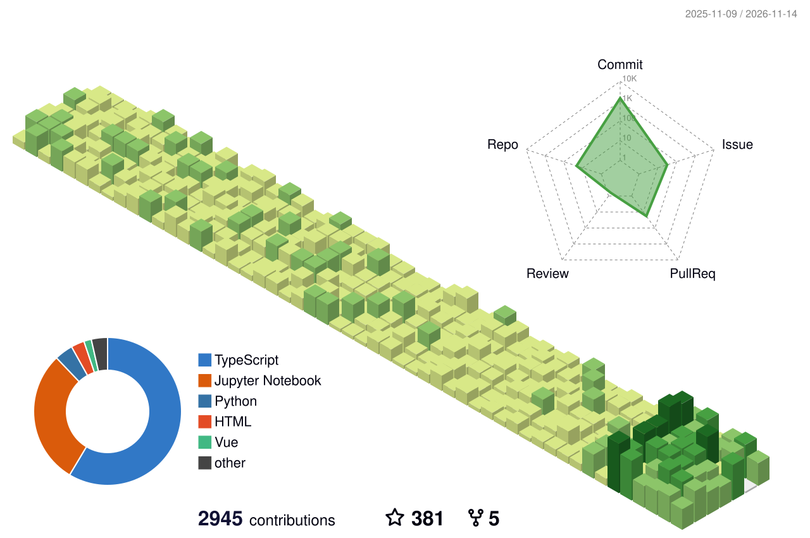

<!-- 该文件由 scripts/update_readme.py 自动生成，请勿直接编辑；改版请改脚本。 -->

#### 最近在做什么

| 项目 | 最近一次提交 | 更新 |
| :-- | :-- | :-- |
|  **[Adelie](https://github.com/lmliheng/Adelie)** | `fix(web,server): 麦克风拿不到时不再怪权限，语音设置能测通不通` | 今天 |
|  **[algorithm](https://github.com/lmliheng/algorithm)** | `feat: micrograd` | 今天 |
|  **[adelie-themes](https://github.com/lmliheng/adelie-themes)** | `feat: 主题库只留四套：赛博朋克、手绘涂鸦、陶光、拟物化` | 7 天前 |

过去 7 天：2 个仓库 · 102 次提交

#### 贡献图

<picture>
  <source media="(prefers-color-scheme: dark)" srcset="https://raw.githubusercontent.com/lmliheng/lmliheng/output-3d-contrib/night.svg" />
  <source media="(prefers-color-scheme: light)" srcset="https://raw.githubusercontent.com/lmliheng/lmliheng/output-3d-contrib/day.svg" />
  
</picture>

最后更新：2026-11-07 09:29（UTC+8）· 由 [scripts/update_readme.py](scripts/update_readme.py) 自动生成 · 3D 贡献图由 [.github/workflows/profile-3d-contrib.yml](.github/workflows/profile-3d-contrib.yml) 每日生成
